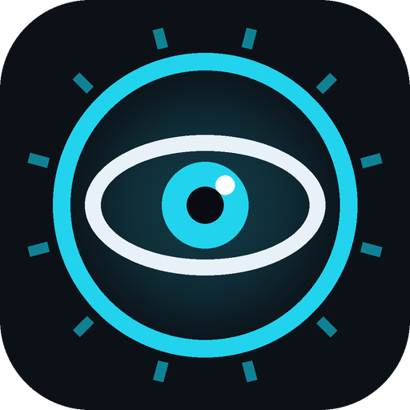
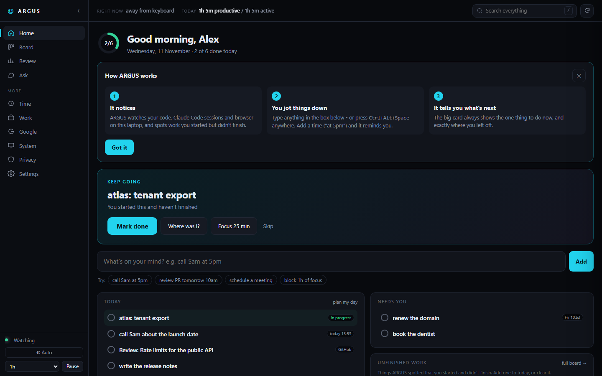
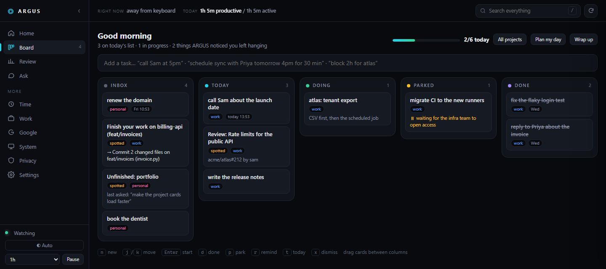
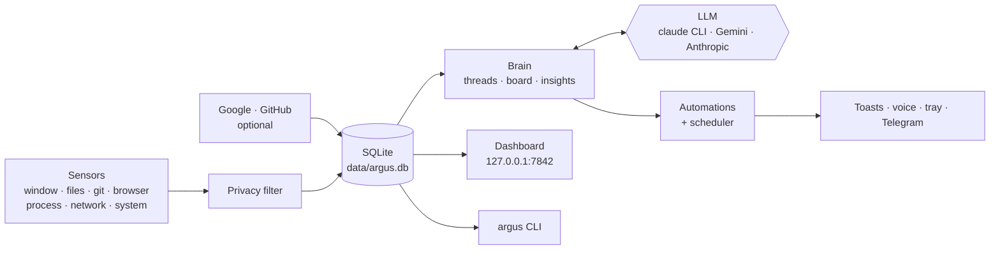

<div align="center">



# ARGUS

**A local-first personal assistant for Windows.**<br>
It watches what you actually did, keeps a board of what to do next, and tells you where you left off.

[](https://github.com/ansh0965/argus/actions/workflows/ci.yml)
[](LICENSE)


[Quick start](#quick-start) · [What it does](#what-it-does) · [Privacy](#privacy) · [Docs](#documentation) · [Contributing](#contributing)

<br>



</div>

## Why

Time trackers tell you where the hours went. To-do apps hold what you typed
into them. Neither knows that you left two files uncommitted on a branch
yesterday, that a review has been waiting on you since Monday, or what you
were in the middle of when the meeting started.

ARGUS does, because it runs on your machine and sees the evidence: your
windows, files, commits, browser history and Claude Code sessions. It turns
that into a board that fills itself, briefings that are about *your* day, and
an answer to "where was I?".

All of it stays in **one SQLite file on your disk**. No account, no cloud, no
telemetry.

## What it does



**A board that fills itself**

- Uncommitted or unpushed work becomes a card, and closes itself when you
  commit and push.
- A project that went quiet mid-way comes back as "Pick back up: X?", with the
  last thing you asked Claude Code.
- GitHub reviews waiting on you, your failing CI and requested changes show up
  as cards and clear themselves when resolved.
- Capture anything with **Ctrl+Alt+Space** from any app: `call Sam at 5pm`,
  `block 2h for atlas`, `schedule sync with Priya tomorrow 4pm for 30 min`.

**"Where exactly was I?"**

- Click a card: branch, uncommitted files, last files touched, last Claude
  asks, commits, windows and pages. One click reopens the project in VS Code
  or resumes the Claude Code session.

**Briefings about your actual day**

- A morning brief, an evening wrap, a weekly retro and a standup draft,
  written from what really happened.
- `argus ask "how did I spend Tuesday?"`

**It looks after things**

- Meeting warnings with prep notes, a focus guardian that notices a
  distraction spiral, inbox triage (it never sends mail), reminders that reach
  your phone over Telegram.
- An alert *before* you commit a secret; nags about stale branches and
  uncommitted work; disk, battery and CPU watchdogs.

**A real desktop app**

- A tray icon, autostart at login, a dashboard at `http://127.0.0.1:7842`, a
  full CLI, and `argus build` to freeze it into `Argus.exe`.
- `argus doctor` checks everything and gives the fix for whatever is broken.

More in [docs/board.md](docs/board.md).

## Quick start

**You need:** Windows 10 or 11, [Python 3.12](https://www.python.org/downloads/), and Git.

```powershell
git clone https://github.com/ansh0965/argus.git
cd argus
python -m venv .venv
.venv\Scripts\python -m pip install -r requirements.txt

.\argus doctor      # checks the setup and tells you what is missing
.\argus start       # start watching, in the background
.\argus dash        # open the dashboard
```

That is a working install. On first run ARGUS rebuilds the last 90 days from
your browser history, git logs and Claude Code transcripts, so the dashboard
is not empty.

Then make it yours:

| Step | How |
|---|---|
| **Tell it what "work" means** | Copy `config.example.yaml` to `config.yaml` and list your company, projects and hosts under `realms`. [Details](docs/configuration.md#work-and-personal) |
| **Start it at login** | `.\argus install` (adds Desktop and Start Menu shortcuts too) |
| **Turn on briefings** | Install [Claude Code](https://claude.com/claude-code) and sign in, or set `GEMINI_API_KEY` or `ANTHROPIC_API_KEY`. [Details](docs/configuration.md#the-brain) |
| **Connect Google** *(optional)* | `.\argus google login --label personal` - calendar, mail, tasks. [Details](docs/google.md) |
| **GitHub cards** *(optional)* | Install the [`gh` CLI](https://cli.github.com) and sign in |
| **Build the app** *(optional)* | `pip install -r requirements-dev.txt`, then `.\argus build` for a double-clickable `Argus.exe` |

> **Just want to look around?** `python scripts/demo.py` runs the dashboard on
> made-up sample data in a temp folder. It watches nothing and touches none of
> your files.

## Everyday commands

```
argus status                 what is running right now
argus today                  today's activity report
argus ask "..."              ask about your own activity
argus resume                 where you left off, by project
argus brief | wrap | retro   generate a briefing now
argus pause 60               stop all watching for an hour
argus timesheet --csv w.csv  the week as timesheet evidence
argus doctor                 health check, with fixes
```

The full list is in [docs/cli.md](docs/cli.md).

## Privacy

ARGUS records what you do, so this is the part that has to be right.

- **Everything stays local.** One file, `data/argus.db`. No telemetry, no
  upload, no account.
- **It never records keystrokes.** There is no keylogger in the codebase.
- **Screenshots are off by default**, local-only and purged after 3 days if
  you turn them on.
- **Sensitive things are filtered before storage**: password managers and
  banking windows are stored as `<private>`, URLs lose their query strings,
  API keys and tokens are masked, and folders you mark private are never
  recorded at all.
- **Pause means pause.** Every sensor stops, and history from the paused
  period is not ingested later.
- **The dashboard answers only to you.** It binds to `127.0.0.1` and refuses
  requests from other websites.
- **The only thing that leaves your machine** is a text summary of your
  activity, sent to the LLM you configured, when a briefing runs. No LLM, no
  summary.
- **It can read your mail if you connect it. It never sends mail and never
  deletes anything.**
- `argus privacy` shows exactly what is stored. `argus export` gets it out.
  `argus purge` deletes it.

The full account is in [docs/privacy.md](docs/privacy.md). Found a hole?
[SECURITY.md](SECURITY.md).

## How it works



One Python process runs the sensors, a scheduler and a FastAPI server over a
single SQLite database. The dashboard is one HTML file with no build step.
The LLM is optional and sandboxed: it gets text in and gives text out, with no
tools and no file access. See [docs/architecture.md](docs/architecture.md).

## Documentation

| | |
|---|---|
| [The board and automations](docs/board.md) | Capture, scheduling, the daily rhythm, everything ARGUS does unprompted |
| [Configuration](docs/configuration.md) | Every setting, with the common edits up front |
| [Command line](docs/cli.md) | Every `argus` command |
| [Connecting Google](docs/google.md) | OAuth client, several accounts, limiting what each may touch |
| [Privacy](docs/privacy.md) | What is recorded, what is filtered, what leaves the machine |
| [Architecture](docs/architecture.md) | How the pieces fit, the data layout, the frozen app |
| [Troubleshooting](docs/troubleshooting.md) | When something is off |

## Project layout

```
argus/
  sensors/        window, files, git, browser, process, network, system, screenshot
  brain/          threads, board, insights, digests, the LLM client
  automations/    what ARGUS does on its own
  actions/        toasts, voice, tray, quick capture, Telegram
  gsuite/         Google auth, Calendar, Gmail, Tasks, Drive
  web/            FastAPI server + the single-file dashboard
  cli.py  daemon.py  db.py  config.py  classify.py  privacy.py  doctor.py  ...
tests/            pytest suite; runs against a throwaway data folder
docs/             guides
scripts/demo.py   the dashboard on sample data
config.example.yaml
argus.spec  launcher.py     PyInstaller build of Argus.exe
```

## Development

```powershell
.venv\Scripts\python -m pip install -r requirements-dev.txt
.venv\Scripts\python -m pytest tests -q
```

The suite (570+ tests) runs against a temporary folder and refuses to start
otherwise, so it can never touch your real data.

## Contributing

Issues and pull requests are welcome. Read [CONTRIBUTING.md](CONTRIBUTING.md)
first - in particular the ground rules: nothing leaves the machine by default,
no keystroke logging, and no real personal data in the repository.

## Status and limits

ARGUS is in beta and was built for one person's daily use before it was opened
up. Worth knowing:

- **Windows only.** The sensors, toasts, tray and autostart use Windows APIs.
- **Tested on Python 3.12.**
- There is no installer yet: you run it from a checkout, and can build
  `Argus.exe` yourself.
- The Google integration needs your own Google Cloud OAuth client.

## License

[MIT](LICENSE) © Anshuman Pandey
