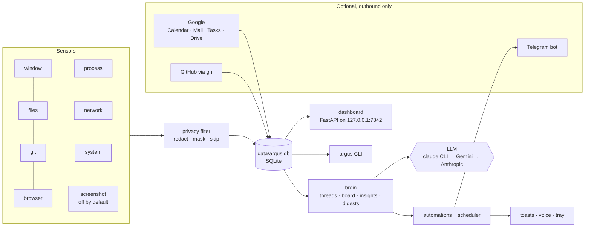

# Architecture

ARGUS is one Python process (the *daemon*) that watches the machine, stores
what it sees in one SQLite file, and serves a dashboard on `127.0.0.1`.
A CLI and a tray icon talk to the same data.



## The pieces

| Folder | What lives there |
|---|---|
| `argus/sensors/` | One module per sensor. Each runs on its own thread, polls or subscribes, and writes rows. A sensor that crashes is restarted (at most three times an hour). |
| `argus/privacy.py` | Everything passes through here before it is stored: private apps and titles become `<private>`, URLs lose their query strings, tokens and passwords are masked, private projects are dropped. |
| `argus/db.py` | Schema, migrations and the small query helpers. One file, `data/argus.db`, in WAL mode. |
| `argus/classify.py` | Turns an exe and a window title into an app, a category (`code`, `comms`, `media`, ...) and a realm (`work` / `personal` / `unknown`). |
| `argus/brain/threads.py` | The thread engine: groups file, git, Claude Code and window evidence into *projects you were working on*, with a confidence score. |
| `argus/brain/board.py` | The board: cards you capture plus cards ARGUS creates (unpushed work, dropped projects, GitHub reviews), reminders, scheduling, plan-my-day, wrap-up. |
| `argus/brain/insights.py` | The numbers: where the time went, focus blocks, hourly rhythm. |
| `argus/brain/digest.py` | Morning brief, evening wrap, weekly retro, `argus ask`. |
| `argus/brain/llm.py` | The one place that calls a model. Provider fallback, a daily call cap, and a sandboxed `claude` CLI. |
| `argus/automations/` | The things ARGUS does unprompted: focus guardian, meeting sentinel, repo janitor, inbox triage, and the rest. Every run is logged. |
| `argus/scheduler.py` | Runs jobs at their times, catches up on what was missed while asleep, and defers network jobs while offline. |
| `argus/gsuite/` | Google OAuth (several accounts) and the Calendar, Gmail, Tasks and Drive clients. `guard.py` enforces "never delete, never send". |
| `argus/actions/` | Ways to reach you: toasts, voice, the tray icon, the quick-capture hotkey, Telegram. |
| `argus/web/` | FastAPI server and the dashboard - a single HTML file, no build step. |
| `argus/cli.py` | Every `argus ...` command. |
| `argus/doctor.py` | Health checks, each with the fix for what it found. |
| `argus/install.py` | Autostart task, shortcuts, and building / swapping in `Argus.exe`. |

## Data

Everything is in the folder ARGUS runs from, so the folder is the app:
copy it somewhere else and your history comes with it.

```
config.yaml            your settings (optional)
data/argus.db          the single source of truth
data/backups/          nightly encrypted snapshots (newest 5)
data/journal/          one markdown file per day
data/secrets/          Google tokens, locked to your Windows user
data/settings.json     what you changed on the dashboard's Settings page
logs/argus.log         rotating log
```

`ARGUS_HOME` points ARGUS at a different folder. The test suite uses it to
run against a throwaway directory and refuses to start otherwise.

## The brain

Briefings and `argus ask` need a language model. Providers are tried in order
(`brain.providers`):

1. **`claude` CLI** - uses your existing Claude Code login, so no API key.
2. **Gemini** - `GEMINI_API_KEY` (or `GOOGLE_API_KEY`) in the environment.
3. **Anthropic API** - `ANTHROPIC_API_KEY` in the environment.

Quick classification jobs prefer Gemini because it answers faster.

Prompts contain text other people wrote (mail subjects, page titles), so the
model is treated as untrusted-input territory. The `claude` CLI runs as a pure
text model: `--tools ""` (it cannot read files or run anything),
`--no-session-persistence`, `--strict-mcp-config`, the prompt over stdin, from
an empty scratch directory. The system prompt tells the model that titles and
subjects are facts to report, never instructions.

`brain.max_daily_calls` (200) is a hard cap so a bug cannot burn your quota.

Without any provider, ARGUS still records, classifies, runs the board and
shows the dashboard - only the written briefings are unavailable.

## Offline behaviour

A watcher probes connectivity every 20 seconds (TCP to public DNS, with
hysteresis and a captive-portal check). Jobs that need the network - Google
sync, mail alerts, Drive, the LLM briefings - are marked `requires_net`.
Offline, they are skipped *without using up their slot*, so they stay due.
When the link returns ARGUS runs what was owed, re-syncs, and tells you what
you missed if you were down for more than 15 minutes.

## History before the first run

On a fresh install ARGUS reconstructs up to 90 days from evidence already on
disk: browser history, git logs and Claude Code session transcripts. Those
rows are marked `exe='<inferred:...>'`, so they are always distinguishable
from live observation, and backfill never overwrites a day the real sensors
recorded. `argus backfill --days 90` re-runs it; it is idempotent.

## The desktop app

`argus build` freezes the daemon into `Argus.exe` with PyInstaller
(`argus.spec`, entry point `launcher.py`).

- `Argus.exe` is windowed, so a double-click never flashes a console. Run a
  second time, it opens the dashboard instead of starting twice.
- `Argus.exe` and `_internal/` sit next to `data/` and `config.yaml` on
  purpose: a frozen build finds its home from the exe's own folder.
- The build runs while the current app keeps working; the swap moves the old
  bundle aside, copies the new one in, and rolls back if anything fails.
- Use `argus` (the launcher script, running from the venv) for the command
  line. The exe can borrow a console for one-off commands, but pipes and `>`
  redirection do not work on a windowed program.

## Tests

`python -m pytest tests -q`. The harness sets `ARGUS_HOME` to a temp folder
before the first import and asserts it took effect, so the suite can never
open your real database. UI behaviour is tested by reading the served HTML
and JSON through FastAPI's `TestClient`; Windows-only pieces are tested
through their pure functions.
